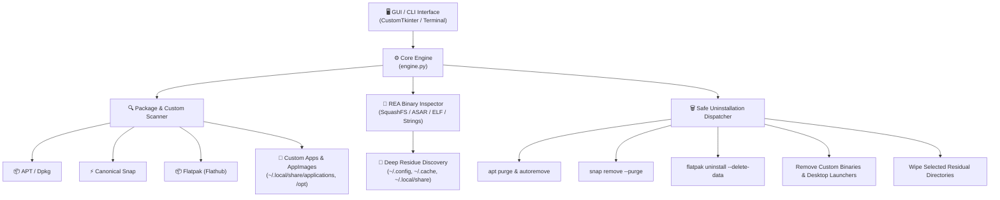

# Universal App Uninstaller for Ubuntu

<p align="center">
  
</p>

<p align="center">
  <b>A unified, cross-source application uninstaller and deep residue purger for Ubuntu & Debian Linux.</b><br>
  Built with a modern Dark-Mode GUI, full CLI tool, and <b>REA-style Reverse Engineering Inspection</b> for custom standalone apps and AppImages.
</p>

<p align="center">
  
  
  
  
</p>

---

## 🌟 The Problem
On Ubuntu, applications are fragmented across multiple package managers and custom installation methods:
1. **APT / Debian packages** (leave behind orphan libraries and configuration files unless purged).
2. **Snap packages** (maintain persistent snapshots and revision data).
3. **Flatpak packages** (store isolated sandboxed user data under `~/.var/app/`).
4. **Custom Standalone Apps & AppImages** (installed into `~/Applications`, `/opt/`, or `~/.local/`, completely invisible to standard software centers).
5. **Leftover Config & Cache Residue** (`~/.config/`, `~/.cache/`, `~/.local/share/`) that can hoard gigabytes of storage long after an app is removed.

**Universal App Uninstaller** bridges this gap by unifying all package sources into a single dashboard and CLI tool with deep reverse-engineering inspection to ensure 100% clean uninstallations.

---

## 🚀 Key Features

- **🌐 Multi-Source Package Management:**
  - **APT / Deb:** Performs `sudo apt purge` and automatic orphaned dependency removal (`autoremove --purge`).
  - **Canonical Snap:** Complete removal with snapshot purge (`sudo snap remove --purge`).
  - **Flatpak:** Uninstalls app with sandbox data wipe (`flatpak uninstall --delete-data`) and cleans unused runtimes (`--unused`).
  - **Custom Standalone & AppImages:** Automatically identifies portable AppImages, tarball installations, custom desktop launchers, and associated binaries.

- **🔬 REA Binary Architecture Inspection:**
  - Evaluates ELF 64-bit headers, AppImage Type 2 SquashFS offsets, and Electron ASAR bundles.
  - Inspects internal `.desktop` files and `package.json` manifests inside AppImages without execution.
  - Scans binary strings to reveal hidden configuration paths (e.g., detecting that an AppImage creates `~/.config/app-name`).
  - Computes SHA-256 binary checksums for forensic verification.

- **🧹 Deep Residual Purger:**
  - Scans `~/.config`, `~/.cache`, `~/.local/share`, `~/.var/app`, and `~/snap`.
  - Calculates directory sizes in real time.
  - Supports **"Clean Residuals Only"** for purging lingering junk from apps uninstalled in the past.

- **🛡️ System-Critical Safeguards:**
  - Essential Ubuntu packages (`systemd`, `ubuntu-desktop`, `gnome-shell`, `libc6`, `snapd`) are flagged with a red **`[SYSTEM CRITICAL]`** badge and blocked from accidental deletion.

- **🎨 Modern Dark Mode GUI & Fast CLI:**
  - Responsive desktop UI powered by CustomTkinter.
  - Zero-dependency interactive terminal CLI with `--dry-run` simulation mode.
  - Batch uninstallation support.

---

## 🏗️ Architecture



---

## 📦 Installation

Clone the repository and run the quick installer:

```bash
git clone https://github.com/ROHANSHAJ/ubuntu-universal-uninstaller.git
cd ubuntu-universal-uninstaller
chmod +x install.sh
./install.sh
```

The installer will:
1. Verify Python 3 and install required UI dependencies (`customtkinter`, `Pillow`).
2. Create command symlinks in `~/.local/bin/` (`uni-uninstaller-gui`, `universal-uninstaller`, `uni-uninstall`).
3. Install the application icon and `.desktop` launcher into GNOME Application Grid.

---

## 💻 Usage

### 1. Graphical Interface (GUI)
Launch from the terminal:
```bash
uni-uninstaller-gui
# or
universal-uninstaller
```
*Or press the `Super` (Windows) key and search for **"Universal App Uninstaller"**.*

- Use the search bar to filter across names, package IDs, or keywords.
- Click filter tabs (`All`, `APT/Deb`, `Snap`, `Flatpak`, `Custom / AppImage`).
- Select an app to view its REA binary report and detected residual folders.
- Click **"Uninstall & Clean Residue"** or check multiple apps for **Batch Uninstall**.

---

### 2. Command Line Interface (CLI)

Interactive search and uninstall:
```bash
uni-uninstall
```

Search directly by name:
```bash
uni-uninstall obsidian
uni-uninstall telegram
uni-uninstall discord
```

Simulate without modifying files (`--dry-run`):
```bash
uni-uninstall firefox --dry-run
```

---

## 🗑️ Uninstallation

If you ever wish to remove this tool from your system, simply run:
```bash
./uninstall.sh
```

---

## 📄 License

Distributed under the MIT License. See [LICENSE](LICENSE) for more information.
